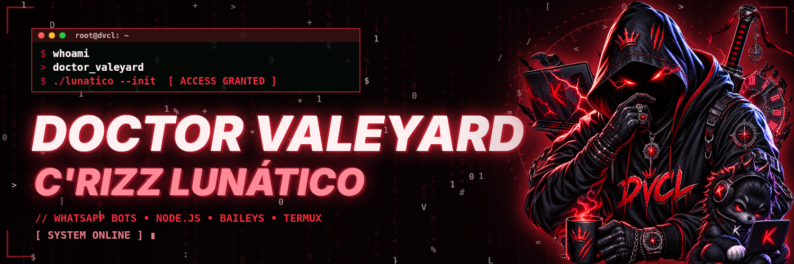

<div align="center">


# 💜 NAGATORO — Bot de WhatsApp

**Se aguenta, fica. Se não aguenta, some.**

Bot de WhatsApp debochado, rápido e completo, feito em Node.js com Baileys.


</div>

---

## 📑 Sumário

- [Sobre](#-sobre)
- [Destaques](#-destaques)
- [Instalação no Termux](#-instalação-no-termux)
- [Ligar de novo (sem baixar nada)](#-ligar-de-novo-sem-baixar-nada)
- [Atualizar o bot](#-atualizar-o-bot)
- [Configuração](#%EF%B8%8F-configuração)
- [Comandos](#-comandos)
- [Áudios e mensagens dela](#-áudios-e-mensagens-dela)
- [Problemas comuns](#-problemas-comuns)
- [Créditos](#-créditos)

---

## 💜 Sobre

A **Nagatoro** é uma bot de WhatsApp com personalidade própria: provocadora, sarcástica e debochada, inspirada na personagem do anime. Ela modera o grupo, faz figurinhas, baixa músicas e vídeos, recebe quem entra, zoa quem sai e não deixa nada passar.

---

## ✨ Destaques

| | Recurso | O que faz |
|:-:|---|---|
| 😏 | **Personalidade debochada** | Responde bom dia, boa tarde, boa noite, prefixo e menu no deboche, alternando áudio e mensagem. |
| 📣 | **Chamado** | Falou "bot" ou "Nagatoro" em qualquer parte da frase, ela responde. |
| 🕵️ | **X9** | Devolve tudo que apagarem: texto, foto, vídeo, áudio, figurinha, documento e localização. |
| 👑 | **Cagueta de ADM** | Avisa (debochando) quem ganhou ou perdeu o cargo de ADM. |
| 🖼️ | **Cards prontos** | Entrada, saída, pedido de entrada, level e casal em cards roxos instantâneos, com a foto de perfil inteira. |
| 🎴 | **Figurinhas** | Imagem, vídeo e GIF viram figurinha (inclusive animada), com nome do pacote e autor. |
| 🎵 | **Música e vídeo** | `play`, YouTube, TikTok, Instagram, Kwai, Pinterest e MediaFire. |
| 🛡️ | **Moderação** | Antilink, anti-palavrão, anti-NSFW, antifake, anti-spam, mute, advertências e lista negra. |
| 💰 | **Economia** | Gold, banco, loja, inventário, missões, ranking, casamentos e amizades. |
| ♻️ | **Sempre de pé** | Se o processo cair por qualquer motivo, ela religa sozinha em 2 segundos. |

---

## 📲 Instalação no Termux

> Use o Termux da **F-Droid** ou do **GitHub**. A versão da Play Store é antiga e dá erro.

**1. Prepare o Termux** (só na primeira vez):

```bash
mkdir -p /data/data/com.termux/cache/apt/archives/partial && pkg update -y && pkg install -y git nodejs-lts ffmpeg python python-pip && pip install -U yt-dlp
```

> Se o `pkg` der erro de **Failed to fetch**, rode `termux-change-repo`, escolha **Main repository**, pegue outro servidor e rode o comando de novo.

**2. Instale e ligue a Nagatoro** (um comando só: cria a pasta `nagatoro`, baixa a bot dentro dela e liga; os módulos são instalados sozinhos):

```bash
cd ~ && rm -rf nagatoro.js nagatoro && mkdir nagatoro && cd nagatoro && git clone https://github.com/DOCTOR-VALEYARD/nagatoro.js . && npm start
```

> Os avisos amarelos `npm warn` são normais, não são erro.

**3. Conecte o WhatsApp.** Escolha uma opção no menu que aparece:

| Opção | Como conectar |
|:-:|---|
| `1` | **QR Code**: WhatsApp → Dispositivos conectados → Conectar dispositivo → leia o QR. |
| `2` | **Código**: digite seu número com DDI (ex.: `5511999999999`). No WhatsApp: Dispositivos conectados → Conectar dispositivo → **Conectar com número de telefone** → digite o código que aparecer. |

Pronto. Quando aparecer **"NAGATORO CONECTADA COM SUCESSO"**, é só usar `.menu` no grupo.

---

## 🔁 Ligar de novo (sem baixar nada)

Fechou o Termux? A sessão fica salva. Não precisa baixar de novo nem conectar o WhatsApp outra vez:

```bash
cd ~/nagatoro && npm start
```

> 💡 Para a bot não cair quando a tela apagar, segure a notificação do Termux e toque em **Acquire wakelock**.

---

## ⬆️ Atualizar o bot

Quando sair versão nova aqui no repositório, rode:

```bash
cd ~/nagatoro && git pull --rebase --autostash && npm install && npm start
```

Isso baixa **só o que mudou**. Sua conexão com o WhatsApp (`auth_info`), suas configurações (`database`) e os dados dos grupos continuam do jeito que estavam.

> [!IMPORTANT]
> **Já usava a versão antiga (antes da V5)?** Rode uma vez o comando do passo 2 da instalação: ele apaga a versão antiga e instala a nova. Depois é só conectar o WhatsApp de novo e, daqui pra frente, usar o comando de atualizar acima.

---

## ⚙️ Configuração

O jeito mais fácil é pela própria bot, sem mexer em arquivo. Num grupo onde você é ADM (ou no PV, sendo o dono):

```
.configurar-bot
```

Por esse painel dá para mudar **prefixo, nome do bot, nome e número do dono, foto do menu, fundo, GIFs e áudios**. Tudo vale na hora, **sem reiniciar**.

Para editar direto no arquivo:

```bash
cd ~/nagatoro && nano config.js
```

| Campo | Para que serve |
|---|---|
| `PREFIX` | Prefixo dos comandos (padrão `.`). |
| `BOT_NAME` | Nome da bot. |
| `OWNER_NAME` / `OWNER_NUMBER` | Nome e número do dono (com DDI, só números). |
| `AI_API_KEY` | Chave da IA (Hugging Face), para o comando `.ia`. |
| `NSFW_API_KEY` | Chave opcional do anti-NSFW. |

---

## 📋 Comandos

> O prefixo padrão é `.` — use `.menu` para ver tudo com botões.

<details>
<summary><b>🎵 Músicas e mídias</b></summary>

| Comando | Função |
|---|---|
| `.play` nome | Pesquisa e baixa música |
| `.video` nome ou link | Baixa vídeo |
| `.tiktok` / `.instagram` / `.kwai` link | Baixa da rede social |
| `.pinterest` link | Baixa do Pinterest |
| `.mediafire` link | Baixa do MediaFire |
| `.letra` artista - música | Letra da música |
| `.s` | Figurinha (responda imagem, vídeo ou GIF) |
| `.gif` / `.toimg` | Converte mídia em GIF ou imagem |
| `.tomp3` | Extrai o áudio de um vídeo |
| `.voz` efeito | Efeitos de voz (esquilo, grave, robô, eco, nightcore...) |
| `.gtts` idioma texto | Texto em voz |
| `.artenome` nome | Seu nome em arte |

</details>

<details>
<summary><b>🎮 Brincadeiras</b></summary>

| Comando | Função |
|---|---|
| `.forca` / `.quiz` / `.adivinha` | Jogos |
| `.jogodavelha` @pessoa | Jogo da velha |
| `.roleta` / `.sortear` | Sorteios |
| `.simi` pergunta | Oráculo responde |
| `.casal` / `.amizade` / `.dupla` | Combinações do grupo |
| `.matar` / `.tapa` / `.beijar` / `.abracar` | Interações com GIF |
| `.signo` nome | Horóscopo |
| `.enquete` | Cria enquete |

</details>

<details>
<summary><b>💰 Economia</b></summary>

| Comando | Função |
|---|---|
| `.gold` / `.saldo` | Seu dinheiro |
| `.daily` / `.checkin` / `.trabalhar` / `.bonus` | Ganhar gold |
| `.depositar` / `.sacar` / `.transferir` / `.extrato` | Banco |
| `.loja` / `.inventario` / `.presente` | Loja e itens |
| `.topgold` / `.topxp` / `.rank` | Rankings |
| `.casamento` / `.divorcio` / `.meucasal` | Relacionamentos |

</details>

<details>
<summary><b>👥 Membros</b></summary>

| Comando | Função |
|---|---|
| `.perfil` | Seu perfil |
| `.registrar` | Registro no sistema |
| `.membros` / `.adms` | Lista do grupo |
| `.rankinativos` | Quem não falou hoje |
| `.resumo` / `.top10` | Atividade do dia |
| `.bot` / `.nagatoro` | Chama a Nagatoro |
| `.bug` / `.sugestao` | Fala com o dono |

</details>

<details>
<summary><b>🛡️ Administração (só ADM)</b></summary>

| Comando | Função |
|---|---|
| `.ban` / `.kick` @pessoa | Remove do grupo |
| `.promover` / `.rebaixar` @pessoa | Muda cargo |
| `.mute` / `.unmute` @pessoa | Silencia |
| `.warn` / `.unwarn` @pessoa | Advertência |
| `.abrir` / `.fechar` | Abre ou fecha o grupo |
| `.marcar` / `.hidetag` | Marca todo mundo |
| `.antilink` / `.antinota` / `.antifake` / `.antinsfw` | Proteções |
| `.antipalavrao` / `.antispam` / `.antiflood` | Proteções |
| `.x9` | Liga/desliga o X9 |
| `.cagueta on/off` | Liga/desliga a cagueta de ADM |
| `.saudacao on/off` / `.antiamor on/off` | Respostas automáticas |
| `.bemvindo 1/0` | Entrada e saída |
| `.blacklist` número | Lista negra |
| `.ia` | Liga/desliga a IA |

</details>

<details>
<summary><b>👑 Dono</b></summary>

| Comando | Função |
|---|---|
| `.configurar-bot` | Painel de configuração |
| `.ligar` / `.desligar` | Liga ou desliga a bot |
| `.restart` | Reinicia a conexão |
| `.broadcast` mensagem | Aviso para todos os grupos |
| `.backup` | Backup dos dados |

</details>

---

## 🔊 Áudios e mensagens dela

Cada situação tem uma pasta de **áudios** e uma de **mensagens**. Ela reveza: uma vez manda áudio, na outra manda mensagem.

```
src/midias/
├── audios/      → coloque os .mp3 aqui (1.mp3, 2.mp3, ...)
│   ├── bomdia/   boatarde/   boanoite/
│   ├── antiamor/ chamado/    menu/
│   └── prefixo/  entrada/    saida/
└── mensagens/   → uma mensagem por linha em mensagens.txt
```

Também dá para subir áudio pelo WhatsApp: `.configurar-bot` → **SUBIR ÁUDIO**.

---

## 🧰 Problemas comuns

<details>
<summary><b>Pediu para conectar de novo / sessão inválida</b></summary>

```bash
cd ~/nagatoro && rm -rf auth_info && npm start
```

</details>

<details>
<summary><b>Figurinha de GIF ou vídeo não sai</b></summary>

```bash
mkdir -p /data/data/com.termux/cache/apt/archives/partial && pkg update -y && pkg install -y ffmpeg
```

</details>

<details>
<summary><b><code>pkg</code> dá "Failed to fetch" / "Could not open file"</b></summary>

A pasta de downloads do Termux foi limpa. Recrie ela e atualize:

```bash
mkdir -p /data/data/com.termux/cache/apt/archives/partial && pkg update -y
```

Se continuar, troque o servidor: `termux-change-repo` → **Main repository** → escolha outro espelho.

</details>

<details>
<summary><b>Música ou vídeo não baixa</b></summary>

```bash
pkg install -y python python-pip && pip install -U yt-dlp
```

</details>

<details>
<summary><b>Erro ao instalar (npm)</b></summary>

```bash
cd ~/nagatoro && rm -rf node_modules && npm install
```

</details>

---

## 👑 Créditos

<div align="center">



<br><br>


Criado por **DOCTOR VALEYARD C'RIZZ LUNÁTICO**

[](https://whatsapp.com/channel/0029VbEHp6CFHWpymLOJGZ28)
[](https://instagram.com/__dvcl__)
[](https://github.com/DOCTOR-VALEYARD)

<sub>💜 Feito com deboche e Node.js. Hehe~</sub>

</div>
